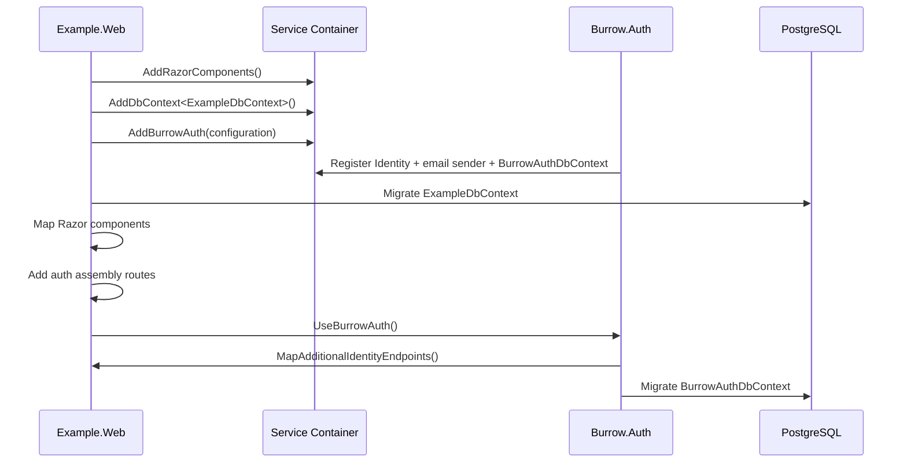

# Burrow Architecture Overview

This document explains how Burrow is structured, how its parts work together at runtime, and which boundaries are intentionally kept stable so projects can be customized and updated safely.

Current version: **0.1.0**

## Architectural Goals

Burrow is designed around four practical goals:

1. **Modular by default**: Features live in independent Burrow modules so applications can include only what they need.
2. **Update-friendly template layout**: Framework/template code is separated from project code to reduce merge pain when pulling upstream updates.
3. **Predictable startup and configuration**: Module integration follows explicit extension methods with clear configuration validation.
4. **Safe data ownership boundaries**: Burrow modules and the host app use separate DbContexts and schema boundaries.

## Top-Level Repository Layout

Burrow uses a two-root architecture in one repository:

- `Burrow/` contains reusable template framework code and docs.
- `src/` contains the host application (currently `Example.Web`).

```text
.
├── Burrow/                        # Template framework
│   ├── src/Burrow.Auth/           # Authentication module
│   ├── tests/Burrow.Auth.Tests/   # Module test suite
│   ├── tools/Burrow.Updater/      # Update tooling (in progress)
│   └── docs/                      # Framework docs
│
├── src/Example.Web/               # Host application
└── docker-compose.yml             # Local PostgreSQL runtime dependency
```

This separation is the core mechanism that keeps downstream customization (`src/`) relatively isolated from framework updates (`Burrow/`).

## Architectural Layers

Burrow follows a pragmatic layered approach:

1. **Host application layer** (`src/Example.Web`)
	- Defines app-specific UI, routes, and data model.
	- Composes Burrow modules through extension methods.
2. **Module layer** (`Burrow/src/Burrow.Auth`)
	- Encapsulates reusable vertical capabilities.
	- Exposes a minimal public integration surface.
3. **Infrastructure layer** (PostgreSQL, configuration, data protection)
	- Shared external dependencies used by both host and modules.

## Runtime Composition

At startup, `Example.Web` composes host and module services in `Program.cs`:

1. Registers Blazor Server services.
2. Registers host `ExampleDbContext`.
3. Registers Burrow authentication services via `AddBurrowAuth(configuration)`.
4. Configures data-protection key persistence (optional).
5. Applies host migrations.
6. Maps Razor components and authentication assembly routes.
7. Applies Burrow.Auth migrations and identity endpoints via `UseBurrowAuth()`.

### Startup Sequence Diagram



## Module Integration Contract

Each module should expose a pair of extension methods:

- `AddBurrow{Module}(IServiceCollection, IConfiguration)` for service registration and configuration validation.
- `UseBurrow{Module}(WebApplication)` for endpoint mapping and runtime initialization.

For `Burrow.Auth`, this contract currently includes:

- ASP.NET Core Identity registration.
- Cookie authentication + authorization services.
- Module DbContext registration.
- Email sender strategy selection (`NoOp`, `File`, `Smtp`).
- Identity endpoint mapping and auth migration execution.

This keeps host code concise while preserving explicit composition in `Program.cs`.

## Data Architecture

Burrow intentionally separates data responsibilities between host and module:

- Host app data uses `ExampleDbContext`.
- Authentication data uses `BurrowAuthDbContext`.

### Schema Boundary Strategy

`Burrow.Auth` maps Identity tables to the `burrow` schema:

- `burrow.AspNetUsers`
- `burrow.AspNetRoles`
- `burrow.AspNetUserClaims`
- `burrow.AspNetUserLogins`
- `burrow.AspNetUserRoles`
- `burrow.AspNetUserTokens`
- `burrow.AspNetRoleClaims`

It also stores module migration history in `burrow.__EFMigrationsHistory`.

This prevents naming collisions and allows the host app to evolve its own schema independently.

### Migration Ownership

- Host migration lifecycle is controlled by the host startup flow (`ExampleDbContext`).
- Module migration lifecycle is controlled by the module startup flow (`BurrowAuthDbContext`).

Both run during app startup, scoped and explicit, rather than hidden in background jobs.

## Authentication and Routing

Burrow.Auth integrates with the host Blazor router by:

- Supplying account components and shared auth UI.
- Mapping additional identity endpoints.
- Requiring confirmed accounts by default.
- Redirecting unauthorized users through the host route pipeline.

The host app includes the Burrow.Auth assembly in Razor component mapping to activate module-provided pages/components.

## Configuration Model

The architecture uses configuration-first behavior with fail-fast validation:

- `ConnectionStrings:DefaultConnection` is required.
- `Email:Sender` selects sender implementation (`NoOp`, `File`, `Smtp`).
- SMTP mode validates required fields (`Host`, `FromAddress`, `FromName`) at startup.
- `DataProtection:KeysDirectory` (optional) enables persistent key storage for multi-instance or restart-safe auth cookies.

This pattern prevents partial misconfiguration from surfacing later at runtime.

## Infrastructure Dependencies

Primary runtime dependency:

- **PostgreSQL 16** (via `docker-compose.yml` in local development)

Development defaults:

- Database: `burrow`
- User: `burrow`
- Password: `burrow` (or `POSTGRES_PASSWORD` override)

Burrow assumes a relational database with EF Core/Npgsql support as a first-class path.

## Testing Strategy

The architecture keeps module tests with the module in `Burrow/tests/Burrow.Auth.Tests`.

Guiding principle:

- Reusable modules own their test suites.
- Host applications can add integration tests for composition behavior.

This avoids coupling module quality to any single downstream app.

## Extension and Evolution Guidance

When adding a new Burrow module, follow these rules:

1. Place source in `Burrow/src/Burrow.{ModuleName}`.
2. Provide `AddBurrow{Module}` and `UseBurrow{Module}` integration extensions.
3. Keep module data in a dedicated schema (`burrow_{module}` recommended).
4. Keep module tests in `Burrow/tests/Burrow.{ModuleName}.Tests`.
5. Avoid direct references to host app internals.

When customizing your app, prefer changes in `src/` and treat `Burrow/` as framework code that may be updated from upstream.

## Current Constraints and Future Directions

Current constraints:

- Single production-ready module (`Burrow.Auth`) today.
- Module discovery/composition is code-driven, not plugin-loaded.
- Automatic startup migrations may need policy changes for strict production environments.

Likely next evolution areas:

- Additional modules (payments, messaging, shared core utilities).
- Stronger update tooling (`Burrow.Updater`).
- More explicit production migration strategies and operational runbooks.

## Summary

Burrow’s architecture is intentionally simple and explicit:

- **Compose modules in host startup**
- **Separate module vs app data ownership**
- **Keep framework and project code in distinct roots**
- **Validate configuration early**

These decisions optimize for real-world maintainability: fast onboarding, safe customization, and practical long-term updates.
